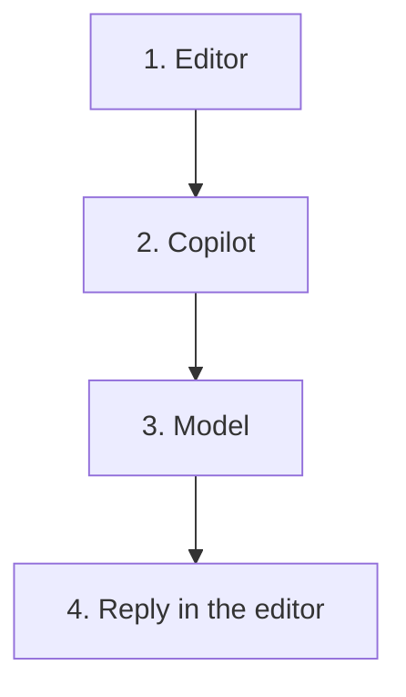

# Module 1 — What Copilot is

Copilot is not the model.

> [!note] Definition — Middleware
> Layer between the editor and the model.
> It builds the request.
> It sends it.
> It puts the reply back.

- The editor gives the cursor and the open files.
- The model answers this text alone.
- The model does not see the project.
- The model does not see the closed files.
- The model can change. This layer stays.
- A copied excerpt enters the request.

## Glossary

| Term | Meaning |
| ---- | ------- |
| Copilot | The middleware. Not the model |
| Model | Reads the request. Produces the reply |
| Request | The only text the model receives |
| Chat | The agent that writes the code |
