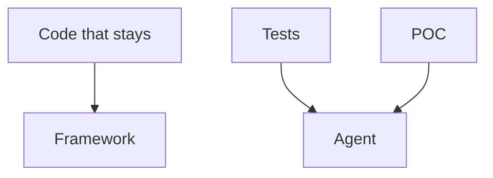

# Module 2 — Chat and the stable product

> [!note] Definition — Chat
> The agent that writes the code.
> Ask and Ctrl+I are not called chat.

- The code that stays is not written in chat.
- Quality and stability matter.
- What is not written is decided in silence.
- Codebase knowledge is lost.
- The framework already saves time.
- Comments. Then completion. Then Ctrl+I.
- Quality code is faster this way. It is also cheaper.

- The agent writes unit tests.
- The agent makes a POC.
- The agent does not write the code that stays.

## Measures

| Source | Finding |
| ------ | ------- |
| Ford, TechSparks 2025 | 85% coverage. More than 2,000 tests for 40 lines. Build from 10 to 25 minutes. Redundant code in production. Human review comes back |
| CodeRabbit, 470 PR | 10.83 problems per PR on the AI side. 6.45 on the human side |
| Veracode, 2025 | OWASP Top 10 flaw in 45% of tasks |
| DORA, 2024 | +25% AI use: about +7.2% instability |
| Replit, July 2025 | Explicit freeze. Production database erased |
| PocketOS, April 2026 | Production volume deleted. Nine seconds |
| GitClear, 2025 | Moved code: 25% in 2021, less than 10% in 2024 |
| METR, July 2025 | 19% more time. Forecast: 24% less. Feeling of going faster |
| Godot, 2026 | Agent contributions refused. Completion kept |
| GitHub, 1 June 2026 | Tokens billed. One agent session costs more than a short question |
