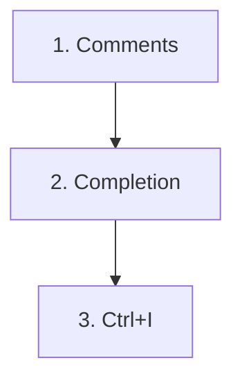
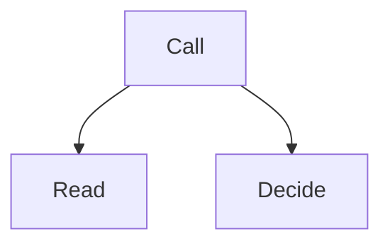

# Module 3 — Comments, completion, Ctrl+I

The code that stays is written with three gestures. Always in this order.

- The algorithm is in comments. In the file. Before the code.
- Completion implements what is written.

> [!note] Definition — Completion
> A suggestion at the cursor.
> It reads the nearby comment.
> It does not choose the decomposition.

- Each keystroke is a new request.
- Ctrl+I adjusts code already written. Ctrl+I is not chat.
- This framework saves time.

## The keys

| Key | Effect |
| ------ | ----- |
| Tab | Accept the suggestion. |
| Escape | Dismiss the suggestion. |
| Ctrl+→ | The next word. Or the next line. |
| Cmd+→ | The same gesture, on Mac. |

[Inline suggestions](https://code.visualstudio.com/docs/editing/ai-powered-suggestions) · [Keyboard shortcuts](https://docs.github.com/en/copilot/reference/keyboard-shortcuts)

## Snooze

- Copilot menu in the Status Bar.
- Each press adds 5 minutes.
- Completion stays quiet during that time.
- Command Palette: « Snooze Inline Suggestions ».
- Resume: « Cancel Snooze Inline Suggestions ».
- No default shortcut.

## Decomposition

- One function. One responsibility.
- Two functions in a chain only call.
- They do not redo the work.

- The caller does not read again.
- It does not decide again.
