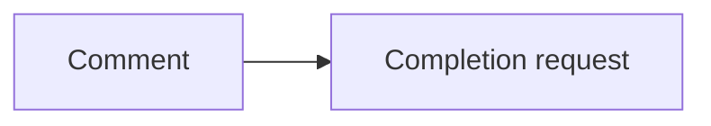
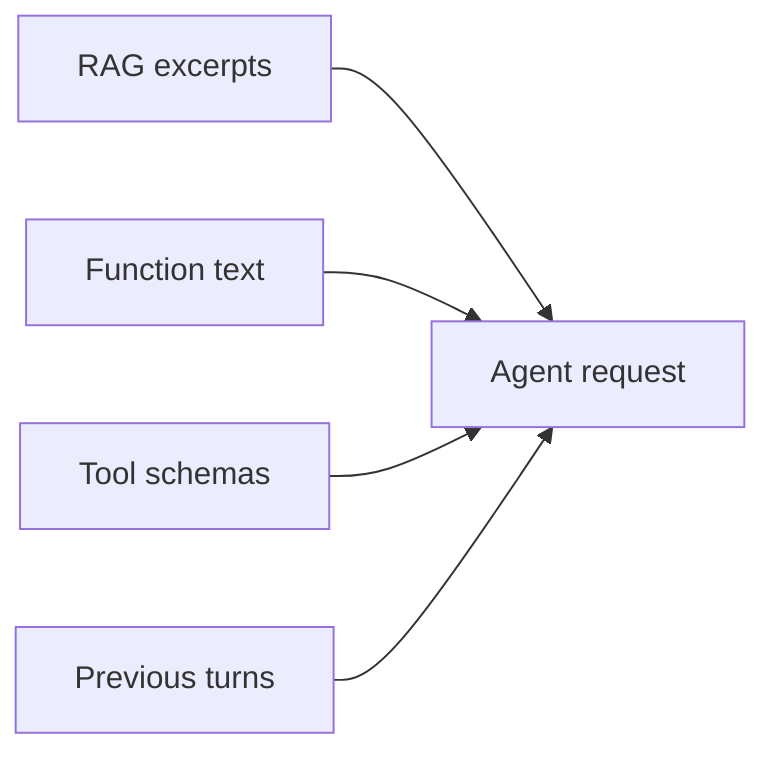
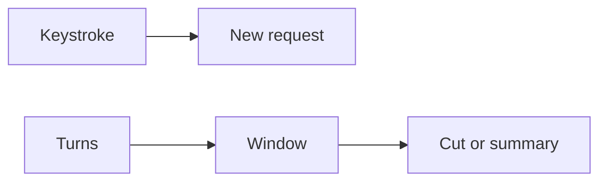
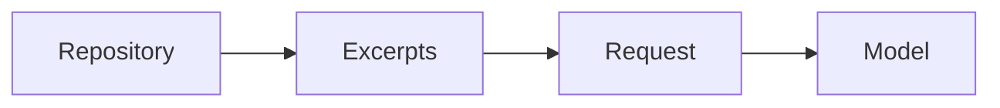
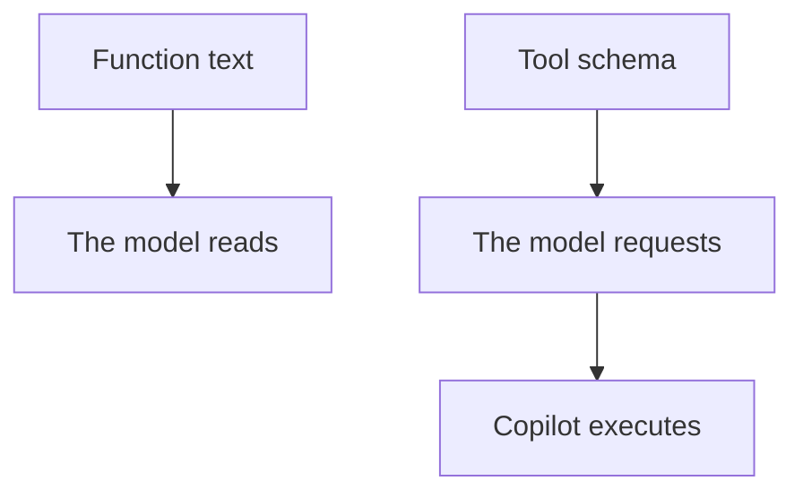

# Module 4 — What goes into the request

> [!note] Definition — Token
> Unit the model reads and produces.
> Neither a character. Nor a word.

> [!example] Example
> Add it if the identifier is absent.

- Not one token per letter.
- Not necessarily one token per word.
- The split depends on the model.
- The window is counted in tokens.
- Each item placed in the request uses tokens.

## History

History: the turns sent back in a request. Neither the editor. Nor the commits.

- Completion has no history. Each keystroke is a new request.
- The comment next to the cursor goes into this request.
- The agent resends previous turns, as long as they fit in the window.
- Beyond that, the oldest ones are cut or summarized.

## RAG

> [!note] Definition — RAG
> Search for repository excerpts.
> These excerpts are pasted into the request.
> The model has no repository memory.

- The repository is searched. Excerpts are pasted. The model reads these excerpts.
- A closed file does not go in just because it is in the folder.

## Two lists

- A function written in the file is text.
- The tool that runs a test is a schema.
- The model requests the schema. Copilot executes it.
