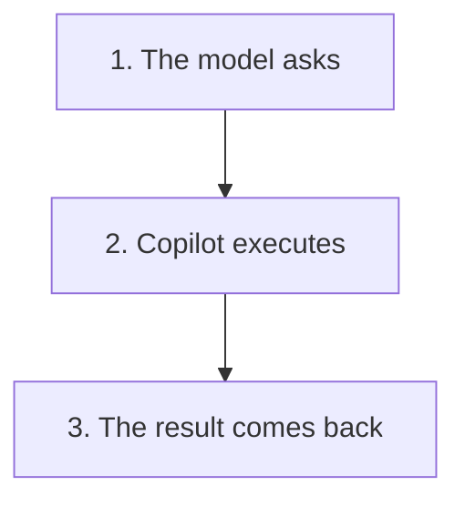

# Module 5 — What an agent is

An agent is the same middleware, with a loop.

- Copilot builds the request.
- It sends it.
- It puts it back.
- Then the loop starts again.

- The model asks for a tool.
- Copilot executes it.
- The result comes back into the next request.

> [!note] Definition — Tool
> Read. Search. Edit. Run a test.

| Tool | Effect |
| ----- | ----- |
| Read | The text comes back into the next request |
| Search | The excerpts come back |
| Edit | The change is applied |
| Run a test | The result comes back |

- RAG puts excerpts back on each turn.
- The agent does not have the project in memory.
- Full window: old turns are cut or summarized.
- The agent writes the unit tests. The agent makes a POC.
- The code that stays: comments, completion, Ctrl+I.
