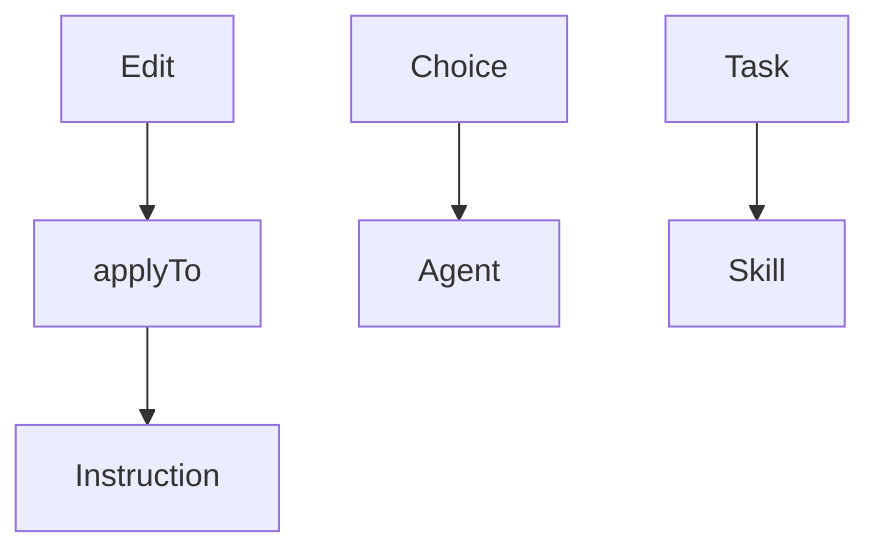

# Module 6 — Configurations

A configuration is a prompt. It enters the request at a precise moment.

- Instructions do not go on every request.
- They go when an edit is sent.
- Only if the touched file matches `applyTo`.

> [!note] Definition — applyTo
> Path pattern.
> File `*.instructions.md`.
> The instruction goes if the file matches.

- A configured agent goes at the moment of the choice.
- It carries the role and the tool list.
- It does not go before that choice.
- A skill goes only when the task matches its description.
- Instruction tokens are paid on that edit.
- The skill is paid only if it is loaded.

| Configuration | File |
| ------------- | ---- |
| Instruction | `.github/instructions/` `*.instructions.md` |
| Agent | `.github/agents/` `*.agent.md` |
| Skill | `.github/skills/<name>/` `SKILL.md` |

## The headers

- Each type has its header list.
- The page gives the complete list.

| Type | Headers | List |
| ---- | ------- | ---- |
| Instruction | `name` `description` `applyTo` | [Header list](https://code.visualstudio.com/docs/agent-customization/custom-instructions#_instructions-file-format) |
| Agent | `description` `name` `tools` | [Header list](https://code.visualstudio.com/docs/agent-customization/custom-agents#_header-optional) |
| Skill | `name` `description` | [Header list](https://code.visualstudio.com/docs/agent-customization/agent-skills#_header-required) |
