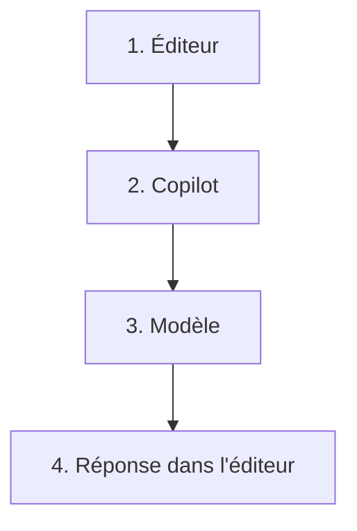

# Module 1 — Qu'est-ce que Copilot

Copilot n'est pas le modèle.

> [!note] Définition — Middleware
> Couche entre l'éditeur et le modèle.
> Elle fabrique la requête.
> Elle l'envoie.
> Elle réinjecte la réponse.

- L'éditeur donne le curseur et les fichiers ouverts.
- Le modèle répond à ce texte seul.
- Le modèle ne voit pas le projet.
- Le modèle ne voit pas les fichiers fermés.
- Le modèle peut changer. Cette couche reste.
- Un extrait copié entre dans la requête.

## Lexique

| Terme | Signification |
| ----- | ------------- |
| Copilot | Le middleware. Pas le modèle |
| Modèle | Lit la requête. Produit la réponse |
| Requête | Le seul texte que le modèle reçoit |
| Chat | L'agent qui écrit le code |
