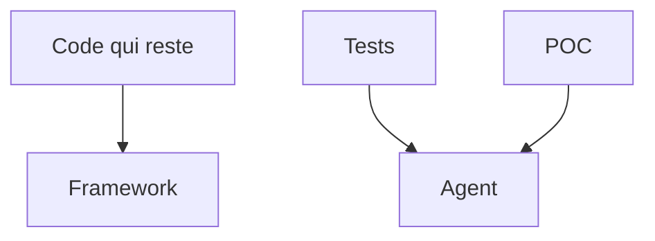

# Module 2 — Le chat et le produit stable

> [!note] Définition — Chat
> L'agent qui écrit le code.
> Ask et Ctrl+I ne s'appellent pas chat.

- Le code qui reste ne s'écrit pas dans le chat.
- La qualité et la stabilité comptent.
- Ce qui n'est pas écrit est tranché en silence.
- La connaissance de la codebase se perd.
- Le framework fait déjà gagner du temps.
- Commentaires. Puis complétion. Puis Ctrl+I.
- Un code de qualité est plus rapide ainsi. Il est aussi moins coûteux.

- L'agent écrit les tests unitaires.
- L'agent fait un POC.
- L'agent n'écrit pas le code qui reste.

## Mesures

| Source | Constat |
| ------ | ------- |
| Ford, TechSparks 2025 | Couverture 85 %. Plus de 2 000 tests pour 40 lignes. Build de 10 à 25 minutes. Code redondant en production. La revue humaine revient |
| CodeRabbit, 470 PR | 10,83 problèmes par PR côté IA. 6,45 côté humain |
| Veracode, 2025 | Faille du Top 10 OWASP dans 45 % des tâches |
| DORA, 2024 | +25 % d'usage d'IA : environ +7,2 % d'instabilité |
| Replit, juillet 2025 | Gel explicite. Base de production effacée |
| PocketOS, avril 2026 | Volume de production supprimé. Neuf secondes |
| GitClear, 2025 | Code déplacé : 25 % en 2021, moins de 10 % en 2024 |
| METR, juillet 2025 | 19 % de temps en plus. Prévision : 24 % de moins. Impression d'aller plus vite |
| Godot, 2026 | Contributions d'agent refusées. Complétion gardée |
| GitHub, 1er juin 2026 | Tokens facturés. Une session d'agent coûte plus qu'une question courte |
