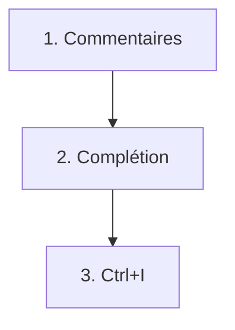
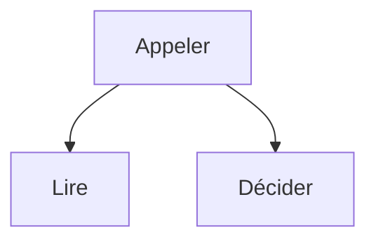

# Module 3 — Commentaires, complétion, Ctrl+I

Le code qui reste s'écrit avec trois gestes. Toujours dans cet ordre.

- L'algorithme est en commentaires. Dans le fichier. Avant le code.
- La complétion implémente ce qui est écrit.

> [!note] Définition — Complétion
> Proposition au curseur.
> Elle lit le commentaire voisin.
> Elle ne choisit pas la découpe.

- Chaque frappe est une requête neuve.
- Ctrl+I ajuste du code déjà écrit. Ctrl+I n'est pas le chat.
- Ce framework fait gagner du temps.

## Les touches

| Touche | Effet |
| ------ | ----- |
| Tab | Accepter la proposition. |
| Échap | Effacer la proposition. |
| Ctrl+→ | Le mot suivant. Ou la ligne suivante. |
| Cmd+→ | Le même geste, sur Mac. |

[Suggestions inline](https://code.visualstudio.com/docs/editing/ai-powered-suggestions) · [Raccourcis clavier](https://docs.github.com/en/copilot/reference/keyboard-shortcuts)

## Le snooze

- Menu Copilot, dans la barre d'état.
- Chaque appui ajoute 5 minutes.
- La complétion se tait pendant ce temps.
- Palette : « Snooze Inline Suggestions ».
- Reprise : « Cancel Snooze Inline Suggestions ».
- Aucun raccourci par défaut.

## La découpe

- Une fonction. Une responsabilité.
- Deux fonctions qui s'enchaînent ne font qu'appeler.
- Elles ne refont pas le travail.

- La fonction qui appelle ne relit pas.
- Elle ne redécide pas.
