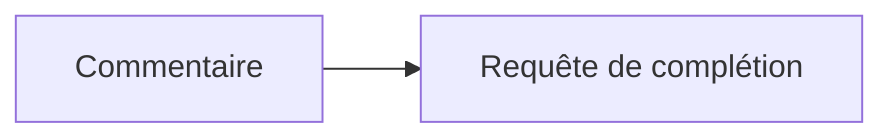
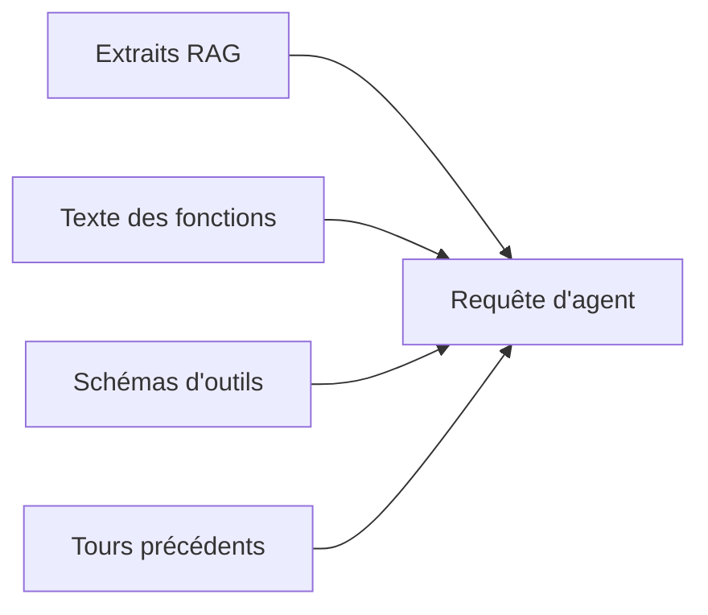
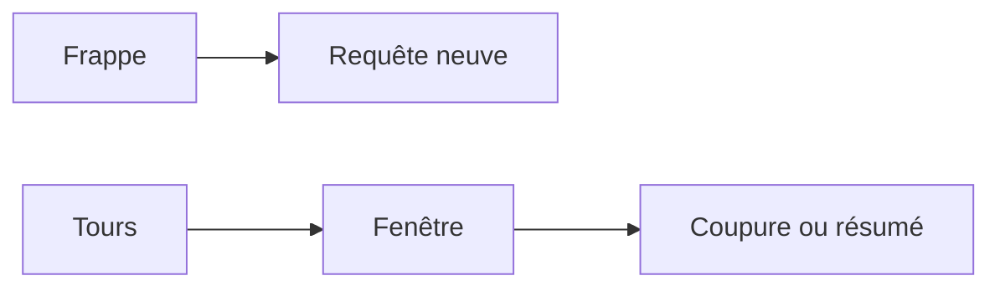
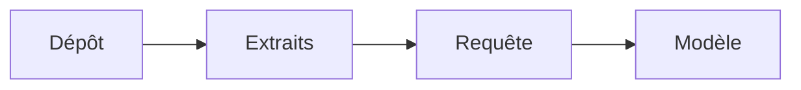
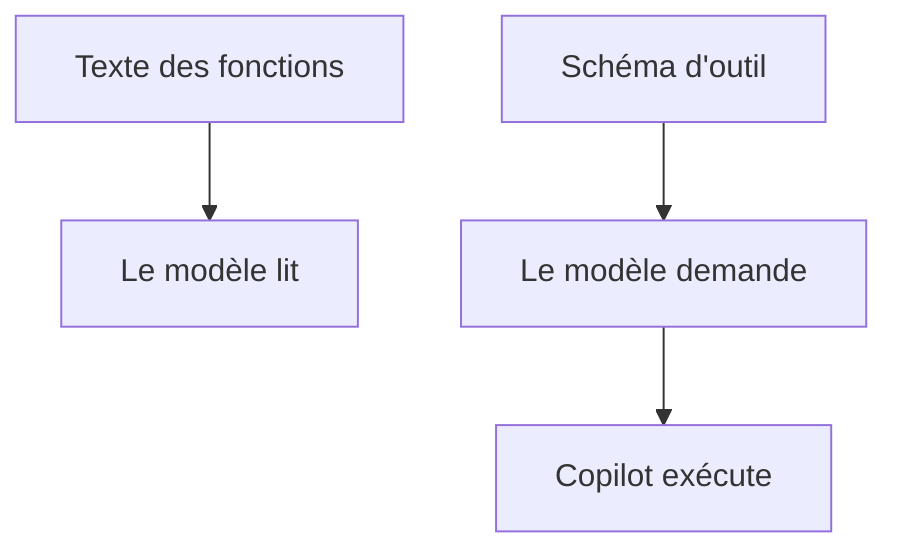

# Module 4 — Ce qui part dans la requête

> [!note] Définition — Token
> Unité que le modèle lit et produit.
> Ni un caractère. Ni un mot.

> [!example] Exemple
> Ajouter si l'identifiant est absent.

- Pas un token par lettre.
- Pas forcément un token par mot.
- Le découpage dépend du modèle.
- La fenêtre se compte en tokens.
- Chaque élément placé dans la requête consomme des tokens.

## Historique

L'historique : les tours renvoyés dans une requête. Ni l'éditeur. Ni les commits.

- La complétion n'a pas d'historique. Chaque frappe est une requête neuve.
- Le commentaire à côté du curseur part dans cette requête.
- L'agent renvoie les tours précédents, tant qu'ils tiennent dans la fenêtre.
- Au-delà, les plus anciens sont coupés ou résumés.

## RAG

> [!note] Définition — RAG
> Recherche d'extraits du dépôt.
> Ces extraits sont collés dans la requête.
> Le modèle n'a pas le projet en mémoire.

- Le dépôt est cherché. Des extraits sont collés. Le modèle lit ces extraits.
- Un fichier fermé ne part pas parce qu'il est dans le dossier.

## Deux listes

- Une fonction écrite dans le fichier est du texte.
- L'outil qui lance un test est un schéma.
- Le modèle demande le schéma. Copilot l'exécute.
