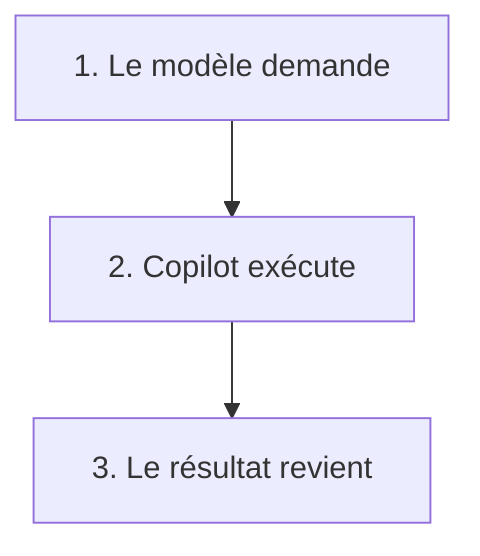

# Module 5 — Qu'est-ce qu'un agent

Un agent est le même middleware, avec une boucle.

- Copilot fabrique la requête.
- Il l'envoie.
- Il réinjecte.
- Puis la boucle recommence.

- Le modèle demande un outil.
- Copilot l'exécute.
- Le résultat revient dans la requête suivante.

> [!note] Définition — Outil
> Lire. Chercher. Modifier. Lancer un test.

| Outil | Effet |
| ----- | ----- |
| Lire | Le texte revient dans la requête suivante |
| Chercher | Les extraits reviennent |
| Modifier | Le changement est appliqué |
| Lancer un test | Le résultat revient |

- Le RAG remet des extraits à chaque tour.
- L'agent n'a pas le projet en mémoire.
- Fenêtre pleine : les tours anciens sont coupés ou résumés.
- L'agent écrit les tests unitaires. L'agent fait un POC.
- Le code qui reste : commentaires, complétion, Ctrl+I.
