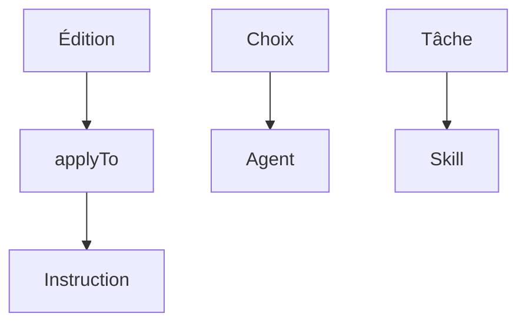

# Module 6 — Les configurations

Une configuration est un prompt. Il entre dans la requête à un moment précis.

- Les instructions ne partent pas à chaque requête.
- Elles partent quand une édition part.
- Seulement si le fichier touché correspond au `applyTo`.

> [!note] Définition — applyTo
> Motif de chemin.
> Fichier `*.instructions.md`.
> L'instruction part si le fichier correspond.

- Un agent configuré part au moment du choix.
- Il porte le rôle et la liste des outils.
- Il ne part pas avant ce choix.
- Un skill part si la tâche correspond à sa description.
- L'instruction est payée en tokens sur cette édition.
- Le skill est payé seulement s'il est chargé.

| Configuration | Fichier |
| ------------- | ------- |
| Instruction | `.github/instructions/` `*.instructions.md` |
| Agent | `.github/agents/` `*.agent.md` |
| Skill | `.github/skills/<nom>/` `SKILL.md` |

## Les en-têtes

- Chaque type a sa liste d'en-têtes.
- La page donne la liste complète.

| Type | En-têtes | Liste |
| ---- | -------- | ----- |
| Instruction | `name` `description` `applyTo` | [Liste des en-têtes](https://code.visualstudio.com/docs/agent-customization/custom-instructions#_instructions-file-format) |
| Agent | `description` `name` `tools` | [Liste des en-têtes](https://code.visualstudio.com/docs/agent-customization/custom-agents#_header-optional) |
| Skill | `name` `description` | [Liste des en-têtes](https://code.visualstudio.com/docs/agent-customization/agent-skills#_header-required) |
